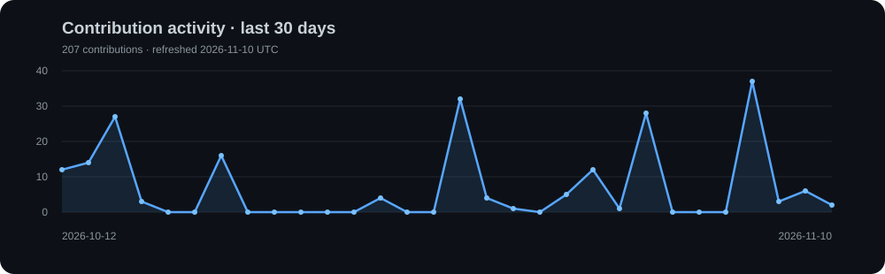

  

<h1 align="center">Hi 👋, I'm Akilan</h1>

<h3 align="center">AI & ML Engineer</h3>

  

Building intelligent systems through machine learning, applied research, and reliable software.

##  <h2 align="center">🚀 About Me </h2>

**Akilan**, Here — a Computer Science and Engineering student specializing in **Artificial Intelligence & Machine Learning**.

I enjoy building inspectable AI systems, reproducible experiments, and practical applications that connect research with real-world engineering.

My work spans **Python, PyTorch, FastAPI, PostgreSQL, and TypeScript**, with a focus on **AI evaluation, data analytics, and retrieval systems**.

My goal is simple: build intelligent software, test assumptions carefully, and preserve the evidence behind every result.

 

 <h2 align="center">🤝 Connect</h2>

  
  &nbsp;&nbsp;&nbsp;
  
  &nbsp;&nbsp;&nbsp;
  

<h2 align="center">💻 Tech Stack</h2>

  

  
  &nbsp;&nbsp;
  
  &nbsp;&nbsp;
  
  &nbsp;&nbsp;
  
  &nbsp;&nbsp;
  
  &nbsp;&nbsp;
  
  &nbsp;&nbsp;
  

<h2 align="center">📊 GitHub Stats</h2>

<h2 align="center">📈 Activity Graph</h2>

  

### 
<h2 align="center">⌘ Commit Activity</h2>

  <picture>
    <source media="(prefers-color-scheme: dark)" srcset="https://raw.githubusercontent.com/akilanpl/akilanpl/output/pacman-contribution-graph-dark.svg?v=2" />
    <source media="(prefers-color-scheme: light)" srcset="https://raw.githubusercontent.com/akilanpl/akilanpl/output/pacman-contribution-graph.svg?v=2" />
    
  </picture>

<h2 align="center">⌘ Philosophy</h2>

  

<!-- Proudly created with GPRM ( https://gprm.itsvg.in ) -->
